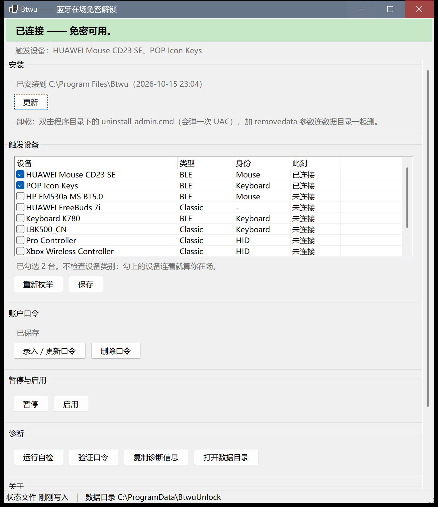

# BltWinUnlock · Btwu

**Turn any Bluetooth device that is paired and connected to Windows into a sign-in credential.**

English | [简体中文](README.md)

The repository is `BltWinUnlock`; the program and its command are **`btwu`** (Bluetooth Unlock).



---

## What it does

- Any Bluetooth device you have already **paired in Windows** becomes the key
- Device connected → the lock screen gains a **default credential tile**; **press Enter to unlock**;
- Device disconnected → the tile is gone, the lock screen looks exactly like stock Windows, and
  pressing Enter does nothing special;
- It does **not** lock the screen for you: locking stays Windows' job (lid close, idle timeout, `Win+L`).

## What it does not do

- **No auto-logon**: after a cold boot, sign-out or user switch you still type your password once;
- No network access, no telemetry, no data leaves the machine.

## Why a credential provider

A normal program cannot unlock Windows — that is by design. The two workable routes are "simulate input"
and "write your own credential provider". This project takes the second one: LogonUI loads it at the lock
screen and it submits the password according to Microsoft's contract, exactly like the built-in password
tile, except that "type your password" becomes "press Enter".
Details: **[docs/技术说明.md](docs/技术说明.md)** (Chinese; the code and its comments are in English).

## Requirements

| | |
| --- | --- |
| OS | Windows 10 / 11, x64 (`win-arm64` can be built from source) |
| Privileges | **One administrator elevation to install** |
| .NET | Nothing to install with the self-contained package; the `-fd` package needs the .NET 10 Desktop Runtime |
| Hardware | Any paired Bluetooth keyboard or mouse. No fingerprint reader, no camera, no phone app |

## Install

1. Grab a package from [Releases](../../releases): `BtwuByKinetix_vX.Y.Z.zip` (self-contained, recommended)
   or `...-fd.zip` (framework-dependent);
2. **Extract the whole folder** ;
3. Double-click **`启动管理面板.cmd`** (start the management panel);
4. Click **安装** in the top section of the panel. **On first run it first asks you to tick your
   trigger devices, then to enter your Windows account password, and only then installs** — one UAC
   prompt for all three steps;
5. Press `Win+L`, then press Enter on the lock screen: you are back on the desktop.

> The password it wants is your **Windows account password, not your PIN**. For a Microsoft account,
> enter that account's password (with the email as the user name); for a local account, the machine
> password. The panel detects which one you have and asks Windows about **both** account-name forms
> during enrollment, keeping the one Windows accepts.

## Usage

| Task | How |
| --- | --- |
| Change trigger devices | Panel → *触发设备* (trigger devices) → tick → Save |
| See what it currently decides | `btwu status` (or the one-line banner at the top of the panel) |
| Temporarily disable passwordless unlock | Panel → Pause, or `btwu pause --minutes 60` |
| Fully automatic (unlock without pressing Enter) | `btwu autosubmit on` |
| Diagnose a problem | `btwu doctor`, also available in the panel's diagnostics section |
| Uninstall | Double-click `app\uninstall-admin.cmd`; it asks whether to delete the data directory |

Full command list: `btwu --help` (Chinese).

## Security model (read this first)

**This is equivalent to leaving the key in the lock.**

- It stores a credential that **can replace your password**: `cred.bin`, encrypted with DPAPI
  (machine scope), ACL limited to SYSTEM and Administrators. **A local administrator can decrypt it** —
  that is unavoidable if you want to sign in without typing anything;
- So: **do not use it on a shared machine**, nor on a machine whose administrators you do not trust;
- Device present means you are present: **if you tick your headphones or phone, their connection counts
  as presence**. To restrict it to HID keyboards only: `btwu enroll --require-hid Keyboard`;
- It cannot tell "keyboard left on the desk" from "person still sitting here" — a weakness shared by
  every device-as-presence scheme.

Please report vulnerabilities privately as described in [SECURITY.md](SECURITY.md), not in a public issue.

## FAQ

**Enrollment says the check failed?** The dialog lists the account forms it tried and the account the
machine is actually signed in with — use the latter. Two common mistakes: entering the Microsoft email
found in the registry (that is just an app sign-in record, not necessarily the Windows sign-in identity),
and entering your PIN. You can also run `btwu doctor`; its second line states whether the account is
local or a Microsoft account.

**No extra tile on the lock screen?** Check, in order: is the device connected (`btwu status`), is the
tool paused (`disable.cp`), is the provider registered (item `[1]` of `btwu doctor`), is `presence.dat`
fresh.

**Why doesn't it lock the screen?** Deliberate. Idle Bluetooth keyboards disconnect to save power, and
"disconnected" cannot be distinguished from "the user left", so "lock on absence" would force everyone to
tune a grace period per keyboard. Locking is Windows' job.

**Does it support Microsoft accounts?** Yes. Note that a Microsoft account signs in as
`MicrosoftAccount\<sign-in address>`, while the same-named local account on the machine is a **different
principal** whose password Windows manages. Windows reports a wrong form exactly like a wrong password,
so the tool tries both forms and adopts whichever is accepted.

## Build from source

Requires the **.NET 10 SDK** and — only for the native credential provider — **Visual Studio Build Tools
with the C++ workload + Windows SDK**:

```bat
build.cmd                                        :: native + .NET, full build
powershell -ExecutionPolicy Bypass -File scripts\install.ps1     :: install (admin)
powershell -ExecutionPolicy Bypass -File scripts\uninstall.ps1   :: full rollback (admin)
powershell -ExecutionPolicy Bypass -File scripts\package.ps1     :: portable package (self-contained)
powershell -ExecutionPolicy Bypass -File scripts\package.ps1 -FrameworkDependent   :: slim package
```

Managed half only (no MSVC needed):

```bat
dotnet publish src\Btwu.Agent\Btwu.Agent.csproj -c Release -o dist\app
```

### Repository layout

```
src/Btwu.CredProv/      native credential provider (C++, security-critical)
src/Btwu.Agent/         resident agent + tray + management panel (one btwu.exe)
src/Btwu.Core/          presence file, credential storage, account-form detection, LSA probes
scripts/                install / uninstall / package / enroll
tools/                  standalone diagnostics (never shipped): LSA diag, state contention test,
                        window capture, pre-release hygiene scan
docs/                   technical notes (Chinese) and screenshots
```

## Known limitations

- Only **local accounts** and **Microsoft accounts** are covered; Entra ID (Azure AD) joined machines are untested;
- Full end-to-end testing was done on Windows 11 (25H2) at 200% scaling; 
- "Presence" is **whether the Bluetooth link is up** — there is no distance information (RSSI is not read),
  so it cannot tell how far away you are.
